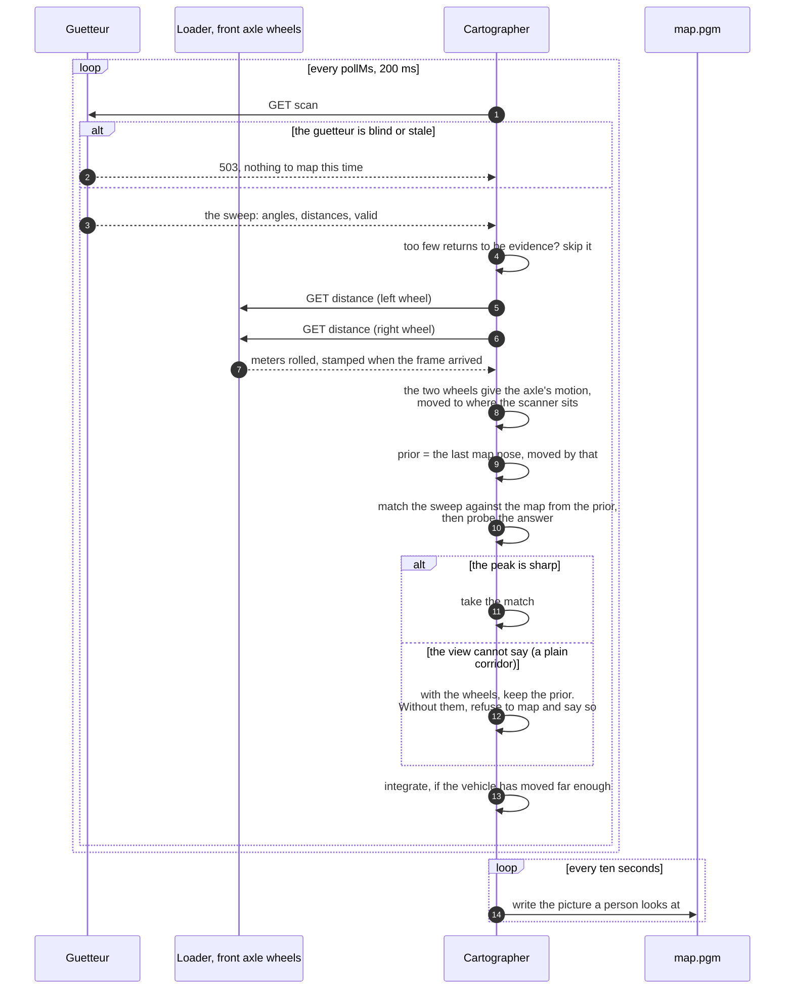
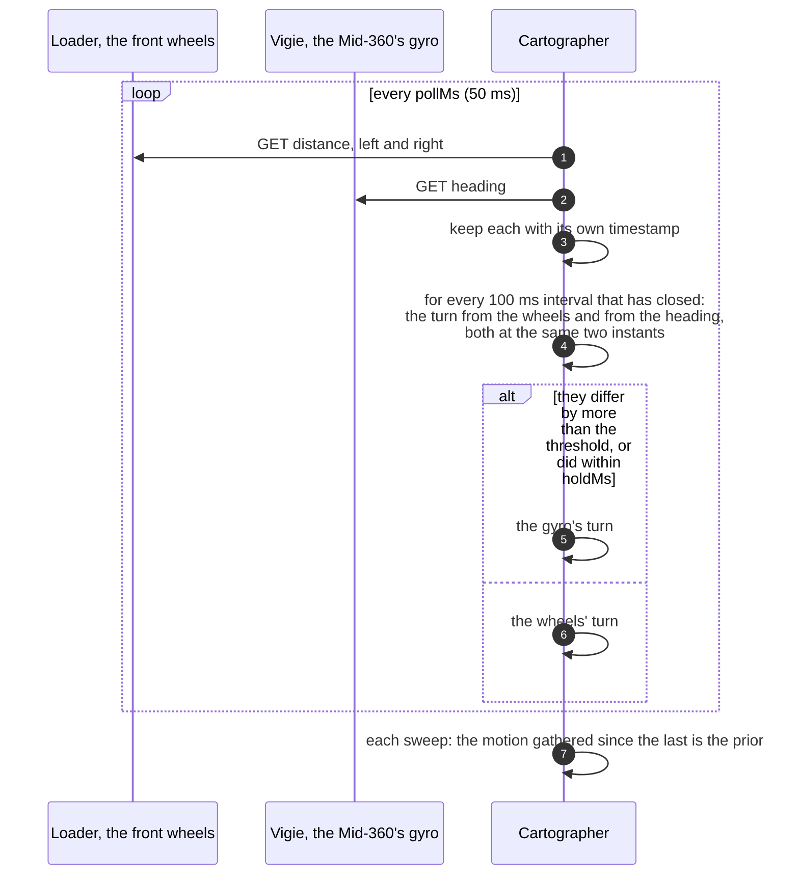

# cartographer

Consumes sweeps from a [guetteur](../guetteur) and builds an occupancy map,
working out as it goes where each sweep was taken from.

It maps and it localizes; it does not drive. Between sweeps it reads how far
the [loader](../loader)'s wheels have turned, and matches each sweep against the
map built so far starting from there. Without the wheels it starts from constant
velocity instead, and refuses to map where the view alone cannot place it.

## Services

| service | form | what it is |
|---|---|---|
| `map` | `MapA_v1a` | the occupancy grid built so far |
| `pose` | `PoseA_v1a` | where in the map the sensor is believed to be |
| `coverage` | `SignalA_v1a` | the share of the grid that has been observed at all |

**Each run is its own map.** The origin is wherever the first sweep was taken,
so after a restart the same coordinates name another place. The `map` and `pose`
forms carry the run in their frame — `map@2026-09-27T06:13:50Z`, the start time —
and anything planned in one run, like a [navigator](../navigator/) route, must be
refused in another.

A `map.pgm` is also written to disk every ten seconds. That is the artefact a
person looks at; the `map` service is what a system consumes.

## One sweep, start to finish



## What it is, and what it is not

By default this is a SLAM **front end**, with no pose graph and no loop
closure. A long circuit of a building will not snap shut when it returns to
where it started: the drift collected on the way round simply stays. For a
hallway driven up and back, which is the experiment the students are being
given, that is the right amount of machinery.

With `loop.enabled` set, a back end is added: keyframes, a pose graph, and a
map redrawn when the vehicle comes back to where it has been. See *Loop
closure* below.

## Three things that are not obvious, and were each found by a failing test

**1. Walls must be recorded as surfaces, not points.** A sweep samples a wall at
intervals that grow with range, so recording only beam endpoints leaves a wall
as a row of dots. A later sweep then scores best by dropping its endpoints back
into those same dots — which is the pose the vehicle has already left. The
matcher fits the sampling pattern instead of the geometry and reports that
nothing has moved. `integrate` therefore joins adjacent returns that are within
30 cm of each other, and the range jump at a doorway is what stops it drawing a
wall across the opening.

**2. Matching scores against a distance transform, not the occupancy grid.**
A Euclidean distance field makes a wall uniformly attractive along its length,
so the along-wall direction carries no false evidence.

**3. A straight corridor cannot say how far along it you are.** Two parallel
walls look identical from everywhere between them. This is the aperture problem
and it is a property of the geometry, not a defect to be tuned away.

So the matcher probes its own answer: it nudges the winning pose and asks
whether the score actually falls. A flat peak is reported as flat, and then:

- **with odometry**, the odometry's position is taken and the matcher is not
  allowed to slide it along the direction the map is indifferent to. The
  **heading** is a separate question: parallel walls fix it even when they
  cannot fix the position, so where the turning probes show a clear peak the
  walls set the heading and the wheels supply only how far the vehicle went.
  The wheels are worst at heading — a few millimetres of tyre or a moment of
  slip is a turn that never happened — and left to them it bends every wall
  drawn after it. `"headingFromWalls": false` turns this off, to compare maps;
- **without odometry**, the sweep is *not* integrated at all, and the system
  says so. A corridor mapped from a pose that cannot be known comes out the
  wrong length and looks entirely convincing.

## Odometry

**The consumed services are the loader's wheel `distance`** — meters rolled by
the two wheels of the scanner's own axle, found by definition `distance`, the
wheel's `NodeID` and the vehicle's `Model`. Between two sweeps the change in
each says how far each side moved. The wheel's size is the loader's business:
it converts revolutions to meters with the circumference in its own
configuration, so calibrating the wheel size means changing one number, there.

**One axle is enough, and the articulation angle is not needed.** An
articulated loader bends in the middle, so its two halves point in different
directions; but each half is a rigid body on two wheels that do not slide
sideways, which is exactly a differential-drive robot. Its axle moves at the
mean of the two wheel speeds and turns at their difference over the track. So
the cartographer tracks the half the scanner is mounted on, from that half's
wheels, and does not need the waist sensor.
The motion is integrated as an arc, and moved from the axle's center to where
the scanner sits (`scannerMount`).

**The motion is applied to the map, not the odometry's position.** The wheel
counters start from wherever the loader was switched on; the map starts from
the first sweep. The prior for each sweep is the previous map pose moved by the
wheels' change. (The first version used an odometry pose directly as the map
pose, and would also have discovered its *own* `pose` service as the odometry
source. Neither ever ran, because nothing provided a pose.)

**Where the view cannot place the vehicle, the wheels do.** Down a plain
corridor the matcher's peak is flat, and the wheel-derived pose is taken as it
is. `odometry_test.go` drives a simulated corridor: with the wheels the estimate
follows the vehicle to the centimeter; without them every sweep is refused.

**What the wheels get wrong, and what guards against it:**

- *Slip.* The loader drives each wheel at the speed the geometry asks for, but
  tires still creep and scrub, most in tight turns, so the heading from the
  encoders drifts. That is why the matcher still corrects wherever the view
  allows.
- *Counter wrap.* The encoder's own counter wraps every 204.8 revolutions; the
  loader unwraps it, so `distance` does not.
- *A loader restart* starts the distances again from zero. A jump larger than
  `maxWheelSpeedMetresPerSecond` allows in the time between readings is taken
  as a restart, not motion, and logged.
- *A dead encoder.* The loader re-sends its latest reading once a second even
  when nothing changes, stamped with when it arrived. A reading older than
  `maxAgeMs` (1.5 s) is not used. The loader and the cartographer must
  therefore agree on the time to within that — run NTP if they are on different
  hosts.
- *Timing.* The wheels are read when a sweep is processed, not when it was
  taken, and a sweep is not de-skewed for motion during it. At walking pace
  that is a few centimeters.

| `odometry` field | default | |
|---|---|---|
| `enabled` | true | absent means true |
| `vehicle` | `{"Model": ["artitrax"]}` | picks the loader |
| `leftNodeID` / `rightNodeID` | 1 / 2 | the **front** axle; 3 / 4 for the back |
| `trackMetres` | 0.6275 | measured |
| `scannerMount` | 0, 0, 0° | forward, left, and yaw of the scanner from that axle's center |
| `maxAgeMs` | 1500 | longer than the loader's one-second heartbeat |
| `maxWheelSpeedMetresPerSecond` | 3 | bounds plausible motion between readings |

**Check the defaults against the vehicle:** they assume the SF45/B is on the
**front** half, over the axle, facing forward. If it is mounted elsewhere, say
so in `scannerMount`, and pick the axle it is on.

## Gyrodometry

**Off unless `gyro.enabled` is true**, and off the cartographer reads the
wheels exactly as described above. On, the heading between sweeps comes from
the wheels except where the [vigie](../vigie)'s gyro says they are wrong —
Borenstein and Feng's *gyrodometry* (ICRA 1996). The reasoning, and how the
gyro was characterized, are in `gyrodometry_proposal_2026-10-20.md`.

Wheels and a gyro fail in opposite ways. The wheels do not drift, once
UMBmark has calibrated the track and the wheel sizes, but a spinning wheel or
a scrubbing tyre is a turn that never happened. The gyro is right over a
fraction of a second, but its bias adds up. So the turn is taken from the
wheels, and from the gyro only over the short intervals in which the two
disagree by more than `thresholdDegreesPerSecond`. The distance is always the
wheels'.



- **The heading, not the rate.** The vigie integrates its gyro at 200 Hz and
  serves the angle, so two readings give the turn between their timestamps
  exactly, however seldom they are read.
- **Per interval, not per sweep.** A tenth of a second, as in the paper, so a
  short slip is isolated rather than spoiling a whole sweep.
- **A hold.** A wheel spinning in a pile disagrees for seconds, wandering
  above and below the threshold; the gyro keeps the turn for `holdMs` after
  the last disagreement. `holdMs: 0` is the paper's rule.
- **Holes fall back to the wheels.** No vigie, a stale heading, or the 503 the
  vigie gives just after a gap in its own stream: the intervals across it take
  the wheels' turn, as without gyrodometry. If the wheels fail and the gyro
  does not, the sweep starts from constant velocity with the gyro's turn.
- **The matcher still has the last word.** Gyrodometry improves the prior;
  where the walls fix the pose, the walls win.

The tests drive a scripted vehicle (`gyrodometry_test.go`). A wheel slipping
20 % for a second while driving straight turns the wheels' heading 18°, and
gyrodometry's 0.65° — the gyro's bias over the event. A biased gyro changes
nothing while the two agree, and the joint swinging at standstill is taken
from the gyro.

| `gyro` field | default | |
|---|---|---|
| `enabled` | false | absent means off |
| `sensor` | `{"Model": ["Livox Mid-360"]}` | picks the vigie |
| `pollMs` | 50 | how often the wheels and the heading are read |
| `intervalMs` | 100 | the paper's T |
| `lagMs` | 100 | how far behind the present the intervals end, so readings from both sides have arrived |
| `maxAgeMs` | 200 | the longest hole in the heading an interval may span |
| `thresholdDegreesPerSecond` | 1.25 | the paper's 0.125° per 0.1 s; to be checked on the vehicle |
| `holdMs` | 300 | 0 is the paper's rule |
| `mode` | `gyrodometry` | `odometry` or `gyro` take the turn from one source always, to compare maps |
| `logPath` | | one CSV line per interval: `t,T,dL,dR,turnWheelsDeg,turnGyroDeg,source` |

Every thirty seconds the log says how often the gyro was believed:

```
cartographer: gyrodometry — 2.1 % of 300 intervals from the gyro, longest 0.6 s, gyro unavailable in 0.0 %
```

**Before trusting it on the vehicle:** set the vigie's mount from gravity (its
README, *Check the mount*), calibrate the wheels with UMBmark
(`umbmark_guide_2026-10-21.md`), and set the threshold from the CSV of a
normal drive: above the 99.5th percentile of |turnGyro − turnWheels| / T.

## Loop closure

**Off unless `loop.enabled` is true**, and off the cartographer maps exactly
as described above. On, it adds a back end: it remembers where each part of
the map was seen from, notices when the vehicle is back somewhere it has
been, and takes the drift collected in between back out of the map. The
reasoning, the maths and the measurements are in
`loop_closure_proposal_2026-11-05.md`.

```mermaid
sequenceDiagram
    autonumber
    participant F as Front end (consume)
    participant M as Memory
    participant L as Loop closer (its own goroutine)

    F->>M: every sweep drawn: kept, hanging off a keyframe;<br/>every 0.5 m or 15°, a new keyframe, with the<br/>wheels' uncertainty since the last
    loop every 500 ms
        L->>M: a snapshot, if there are new keyframes
        L->>L: for each: the older keyframes 10 m or more back<br/>along the path and near by the map; match against<br/>a submap drawn from them
        alt scores well, fixes two directions, and twice in a row
            L->>L: into the pose graph; optimise; its χ² must agree<br/>with the rest of the graph
            L->>L: draw the map again from the keyframes, outside the lock
            L->>F: swap the map in, and move the vehicle with it
        end
    end
```

- **Keyframes.** Every sweep the front end draws is kept, as float32, hanging
  off a keyframe by its offset. Every `keyframeTravelMetres` or
  `keyframeTurnDegrees` one of them becomes a keyframe: a node of the pose
  graph. Between keyframes the uncertainty of the motion is grown step by
  step; that is the weight of the edge between them.
- **Weighed by what placed each sweep.** Where the wheels alone placed a
  sweep, its step grows with `noise`. Where the walls placed it, its heading
  grows only by `matchedHeadingDegreesPerMeter` and `matchedTurnFraction` of
  any turn. Down a straight corridor the walls hold the heading sweep after
  sweep, so the drift a loop finds goes to the corners, where a new corridor
  is drawn from a turn. Where the walls held only the heading, the position
  along the corridor grows by `corridorAlongFraction` of each step.
- **Finding a loop.** A keyframe is matched against the older keyframes at
  least `minGapMetres` back along the path, and near enough by the map that the
  drift could explain the rest. The match is against a submap drawn from the
  older keyframe and its neighbours, not against the whole map: the whole map
  already holds the doubled wall the loop is meant to remove.
- **Believing it.** Corridors repeat, and a convincing match in the wrong place
  folds the map. So a match must score at least `minScore` per return. It must
  fix at least two directions. One that fixes only two, as in a corridor,
  keeps only its heading: the direction the corridor does not fix is never
  found exactly, and the rest of the match is not to be trusted. It must be
  found again from the next keyframe with the same correction. And once in the
  graph, it must agree with the rest, within `maxChi2`.
- **Optimising.** Levenberg–Marquardt on the graph, by conjugate gradients
  preconditioned by the chain of keyframes. A new loop starts from the headings
  and then the positions solved alone, and is judged without a robust kernel;
  loops already accepted get a Cauchy kernel (`robustScale`), so that one
  later found to be wrong cannot fold the map.
- **Redrawing.** When some keyframe moves more than `redrawMetres`, the grid is
  drawn again from every kept sweep, outside the lock, and swapped in. The
  vehicle's pose moves with the newest keyframe, and a sweep matched against
  the old grid during the swap is moved too. The frame stays
  `map@<start time>`; the `pose` service jumps once, by the size of the
  correction.

The tests drive the ring corridor of `loops_test.go`, 20 × 10 m round a block,
with a twentieth of a degree of phantom turn every metre:
- the end keyframe goes from 0.25 m out to 4 mm;
- the share of drawn walls within 10 cm of a real one goes from 60 % to 97 %
  (98.6 % with `freeRangeMetres` off; see below).

A plain corridor driven up and back with wheels reading 3 % long accepts
23 loops, none of which moves a keyframe along the corridor. A 1 km loop of
2000 keyframes with 100° of drift in it closes in one iteration and 8 ms
(`BenchmarkALongLoop`).

| `loop` field | default | |
|---|---|---|
| `enabled` | false | absent means off |
| `keyframeTravelMetres` / `keyframeTurnDegrees` | 0.5 / 15 | |
| `noise` | 3 % along, 2 % across, 1.5 °/m, 10 % of a turn | where the wheels alone placed a sweep; lower `headingDegreesPerMeter` with gyrodometry |
| `matchedHeadingDegreesPerMeter` / `matchedTurnFraction` | 0.1 / 0.02 | the heading's noise where the walls placed a sweep |
| `corridorAlongFraction` | 0.25 | the along-track noise where the walls held only the heading |
| `maxSweeps` | 20000 | past it the oldest are thinned; keyframes are kept |
| `minGapMetres` | 10 | how far back along the path a loop must reach |
| `searchRadiusMetres` / `driftFraction` | 2 / 0.05 | how near by the map, growing with the path between |
| `maxCandidates` | 3 | |
| `submapMetres` / `submapKeyframes` | 16 / 5 | |
| `search` | ±1.2 m, ±20°, 0.10 m / 2° → 0.0125 m / 0.5° | as the front end's `search` |
| `minScore` | 0.55 | per return; 1 is every return on a wall |
| `consistentMatches` | 2 | keyframes in a row |
| `maxChi2` | 7.8 | χ² of three degrees of freedom at 95 % |
| `robustScale` | 3 | Cauchy, in standard deviations, on loops already accepted |
| `maxIterations` | 20 | |
| `redrawMetres` | 0.05 | |
| `logPath` | | one CSV line per match tried, and one more for each put to the graph: `t,i,j,score,seen,dx,dy,dthetaDeg,chi2,believed,accepted`. `chi2` is the one `maxChi2` judges, before the robust kernel; 0 on lines for matches not put to the graph |
| `graphPath` | | the pose graph in g2o format, after each closure |

**First tried on the vehicle on 5 November**, on a laptop, with a 250 m grid.
The first loop closed. Later in the run, closures found from one stale
snapshot stacked on each other and turned the map 20–30°. That is fixed:
see the proposal, section 3.6, and `TestALaggingCloserClosesTheLoopOnce`.
What else that run changed:
- **The size of the grid no longer costs anything.** The likelihood field is
  rebuilt only over the part of the grid anything has been drawn in, plus a
  margin. On a 250 m grid (25 million cells) a rebuild took 466 ms, after
  every sweep drawn and after every redraw. It now takes 2.5 ms
  (`BenchmarkRebuildFieldOn250Metres`).
- **Drawing allocates nothing.** Every beam used to build a list of cells.
  A redraw of the ring on a 250 m grid went from 327 ms to 122 ms
  (`BenchmarkRedrawOn250Metres`), and the front end draws each sweep faster
  too.
- **`maxCandidates`** is how many older keyframes each new keyframe is tried
  against, nearest first. Each try is a submap and a wide search. If the log
  says the loop closer fell behind and skipped keyframes, 1 is a third of the
  work.
- **The scanner:** the cartographer's `scan` cervice still takes any provider,
  guetteur or vigie, and it should be pinned to the vigie.

**Driven again on 6 November**, once round the block with a reverse and a
loop in a side room, with `logPath` and `graphPath` set. The loop closed
(60 loops), but the inner walls came out doubled, and white wedges crossed
them into the block. The g2o and the loop log said why:
- **The straights were curved.** The last closure, 1.14 m, went into the
  graph with 0.01 m of stretch and 1.5° of turn, spread along the straight
  corridors: the keyframes of the top corridor disagreed in heading by 0.78°,
  and a wall seen from both ends of it was drawn twice. The edges are now
  weighed by what placed each sweep (above).
- **Matches that drifted were believed.** Driving on past where it had turned
  round, the vehicle matched an old keyframe's long view of the corridor
  ahead: −0.5°, −1°, −1.5°, −2° in four keyframes. The rest of the graph
  disagrees with them by up to 2.1°, but the old weights let the chain bend
  to meet them. Against the new weights, `maxChi2` refuses the worst of them.
- **Long beams cleared walls.** A beam now clears the cells only out to
  `freeRangeMetres` (12 m, in the main traits; negative for no limit), and
  its return is drawn wherever it is. A beam 20 m down a corridor from a
  keyframe half a degree out passes 17 cm to the side and, at a grazing
  angle, undoes the wall it runs along.

The run's graph, solved again with the new weights and judged again by
`maxChi2` (`replay_test.go`, `-tags replay`): 3 of the 60 loops are refused,
among them 127 ↔ 77. The heading spread along each straight falls from
0.38–0.78° to 0.10–0.27°, and the closing loop still fits (χ² 1.5).

The drive was also replayed through the whole cartographer
(`simulate_test.go`, `-tags sim`), with the wheels' logged motion as the truth
and a sweep ray-cast from the run's map at each pose. The replay is chaotic:
which loops get in decides the result, so one run says little. Over four
wheel-size errors (0.99, 0.995, 1.005, 1.01):

| | end error | keyframe error, mean / worst | heading spread over 20 keyframes |
|---|---|---|---|
| before | 2.75 m | 1.16 / 2.71 m | 5.2° |
| the new weights | 2.73 m | 1.19 / 2.69 m | 3.8° |
| the new weights and `freeRangeMetres`, as shipped | 1.57 m | 0.77 / 1.92 m | 3.7° |

Three other changes were tried and taken out, because the replay was worse
with them (3.13 m, 1.35 / 3.26 m) and kept a third fewer loops:
- submaps drawn only out to `matchRangeMetres`;
- a 1° heading tolerance between matches, and a check against recently
  accepted loops;
- a floor under each match's uncertainty.

Drawing nothing at all beyond 12 m, rather than only clearing nothing beyond
it, was worse still (4.8 m at 0.99). With less map to match against, the front
end drifted.
- The log line "the vehicle moved … m" after a redraw was the translation of
  the correction, a turn about the map's origin; it is now the vehicle's own
  displacement.
- The run's configuration still had `minOverlap`, `positionOverlap`,
  `matchedMetres` and `matchedDegrees` from the reverted commits. This
  version does not read them, and an unknown field is silently ignored.
