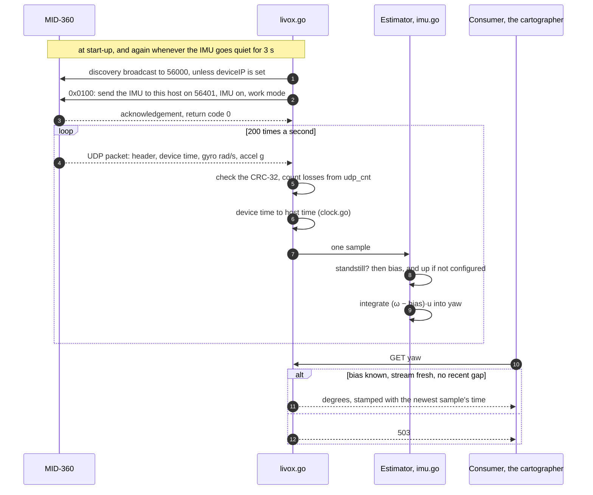

# lidar

*A working name, to be replaced.* The Livox MID-360 as an Arrowhead system.
Today it serves the gyro inside the device, as the angle the vehicle has turned
about the vertical. The point cloud will be a second asset in this same system,
because it comes from the same device, over the same link and on the same clock,
and it has to be de-skewed with this same gyro.

It is the sensor and nothing more, like the [guetteur](../guetteur). It knows
the Livox protocol, the device's clock, and which way is up for the mount it was
calibrated on. It knows nothing about wheels or maps. Combining the yaw with the
wheels belongs to the [cartographer](../cartographer); see
`cartographer/gyrodometry_proposal_2026-10-20.md`, step 1 of which is this
system.

## Services

Asset `IMU`, `Model: Livox MID-360`.

| service | form | what it is |
|---|---|---|
| `yaw` | `SignalA_v1a`, degrees | turned about the vertical since the bias was first known, positive to the left (ISO 8855), never wrapped, bias removed. Stamped with this computer's time for the newest sample in it |
| `yawRate` | `SignalA_v1a`, deg/s | the mean over the last 50 ms, for diagnostics |
| `bias` | `SignalA_v1a`, deg/s | the gyro's bias about the vertical, stamped with when it was measured |

`yaw` and `yawRate` answer **503** in three cases: before the first standstill
has given a bias, when the newest sample is older than `staleAfterMs`, and for
`staleAfterMs` after a gap in the stream. `bias` answers 503 only before the
first standstill.

**For a consumer:** the turn between two readings of `yaw` is exact, whatever
the interval between them. If a 503 came between the two readings, that
difference must not be used. The stream may have dropped part of a turn there.

## From the device to `yaw`



## The two ideas worth understanding

**The angle, not the rate.** The IMU samples at 200 Hz; the cartographer polls
at 20 Hz. A polled rate keeps one sample in ten, vibration aliases into it, and
the integral between two polls is lost. This is the quantity gyrodometry
compares. So the integration happens here, at the full rate. This is what the
loader already does for the wheels: `distance` is metres since start-up, never
wrapped, and stamped.

**About the vertical, not about the sensor's z.** The MID-360 is tilted forward
to see the floor. Tilted by α, its z gyro reads every turn cos α short, 13 % at
30°, and picks up sin α of every roll. The rate used here is the gyro vector
projected on the unit **up** vector **u**, measured in the sensor's frame:
ψ̇ = **ω**·**u**. Roll and pitch rates are perpendicular to **u** and drop
out; the whole turn is kept. Nothing needs to know how the sensor's axes are
laid out.

**u** is set in `upVector`. If it is absent, it is measured from the
accelerometer at the first standstill, and the log line gives the value to paste
in:

```
lidar: measured up as [-0.4999, 0.0000, 0.8661], a tilt of 30.0° from the sensor's z. This assumes the vehicle stood on level ground; to keep it, add "upVector": [-0.4999, 0.0000, 0.8661] to the IMU's traits
```

Measure it on level ground, and again whenever the mount is touched.

## The bias, and standstills

A standstill is a window of `standstillSeconds` in which the accelerometer
reads 1 g to within `standstillAccelToleranceG` and the gyro's standard
deviation stays under `standstillGyroStdDegPerSec`. The gyro's mean over such a
window is the bias. `yaw` answers only after the first one, so **start the
system with the vehicle standing still.**

A slow, steady turn also has a small variance, and would pass that test. It is
told apart by its mean:

- before the first bias, the mean rate must be under
  `standstillMaxRateDegPerSec`;
- after it, a window whose mean is more than `maxBiasStepDegPerSec` from the
  current bias is counted as *still but off the bias* and is not used.

If that count keeps climbing while the vehicle really is still, the first bias
was wrong (the vehicle was moving at start-up). Restart it standing still.

Driving perfectly straight on smooth ground can also pass the test. That does
no harm: the true yaw rate is zero then too.

## Running it without the sensor

The template ships `"source": "simulated"`: a gyro tilted 30° forward with a
bias of 0.5°/s on every axis, which stands still, turns left 90°, rocks ±2°
from side to side, and turns back, every 27 seconds.

```
go build -o lidar_amac . && ./lidar_amac     # the first run writes the config
./lidar_amac
curl http://localhost:20202/lidar/IMU/yaw
```

`yaw` should come back to about 0 at the end of every cycle, and must not move
while the simulator rocks.

## On the vehicle

Set `"source": "livox"`. The computer needs an address on the MID-360's
network. Per the MID-360 manual, the device is 192.168.1.1XX, where XX is the
last two digits of its serial number, so for example 192.168.1.50/24 on the
Ethernet port. Open UDP 56101 (control) and 56401 (IMU) in the firewall.

With `configureDevice` true, the default, the system sends the configuration
itself, so neither Livox Viewer nor the SDK is needed. It sends it again
whenever the IMU stream has been quiet for 3 s, so a device that restarts or is
plugged in late is set up again without a restart here. With `false`, the
system only listens, for a device set up beforehand in Livox Viewer.

**Not yet checked against the device.** The protocol is written from the Livox
SDK2 header and the MID-360 protocol page (see the comment at the top of
`livox.go` for which points were read and which were assumed). The tests are
built from the same reading, so they cannot catch a misreading. The first job
on the vehicle is a capture:

```
sudo tcpdump -i eth0 -w mid360.pcap udp port 56401 or udp port 56101
```

The things to check in it are the IMU packet's header and CRC, one sample per
packet, the layout of the acknowledgement, and whether the IMU still flows in
`"workMode": "idle"`. A few of those packets then go into `testdata/` as the
test the current tests cannot be.

Then the acceptance test: turn the vehicle by hand through 360° on the spot.
`yaw` must read **360° ± 1°**, and positive to the left.

| field | default | |
|---|---|---|
| `source` | `simulated` | `livox` for the device |
| `deviceIP` | empty | empty means find it by broadcast |
| `hostIP` | empty | empty means the local address on the route to the device |
| `imuPort` / `controlPort` | 56401 / 56101 | on this computer |
| `pointCloudPort` | 56301 | reserved for the point cloud, not opened yet |
| `configureDevice` | true | false only listens |
| `workMode` | `sampling` | or `idle` |
| `upVector` | absent | **u** in the sensor's frame; absent means measure at the first standstill |
| `standstillSeconds` | 2 | |
| `standstillAccelToleranceG` | 0.05 | placeholder until the gyro is characterized on the vehicle |
| `standstillGyroStdDegPerSec` | 0.3 | placeholder, likewise |
| `standstillMaxRateDegPerSec` | 2 | the largest bias accepted at the first standstill |
| `maxBiasStepDegPerSec` | 0.2 | how far a later standstill may move the bias |
| `rateWindowMs` | 50 | what `yawRate` averages over |
| `staleAfterMs` | 100 | how old the newest sample may be |
| `maxGapMs` | 50 | the longest hole integrated across |
| `simBiasDegPerSec`, `simNoiseDegPerSec`, `simTiltDegrees` | 0.5, 0.05, 30 | the simulator only |

Every 30 seconds the system logs how the stream is doing:

```
lidar: 6000 IMU packets, 0 bad CRC, 0 lost, 0 malformed, 0 of another type, clock offset spread 0.31 ms; bias 0.042°/s, yaw 123.4°; 6000 samples, 14 standstills, 0 still but off the bias, 0 gaps
```

If every packet is a *bad CRC*, the checksum covers something other than the
documents say. That is the first thing the capture will show.
